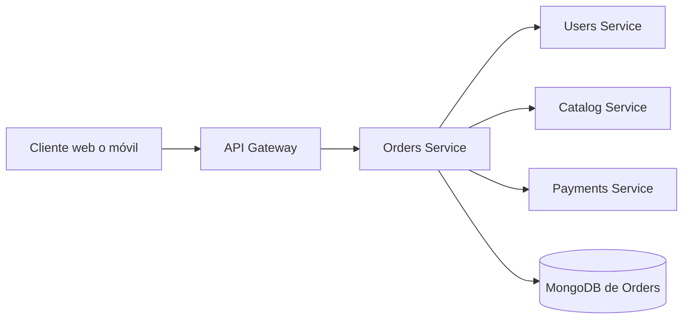
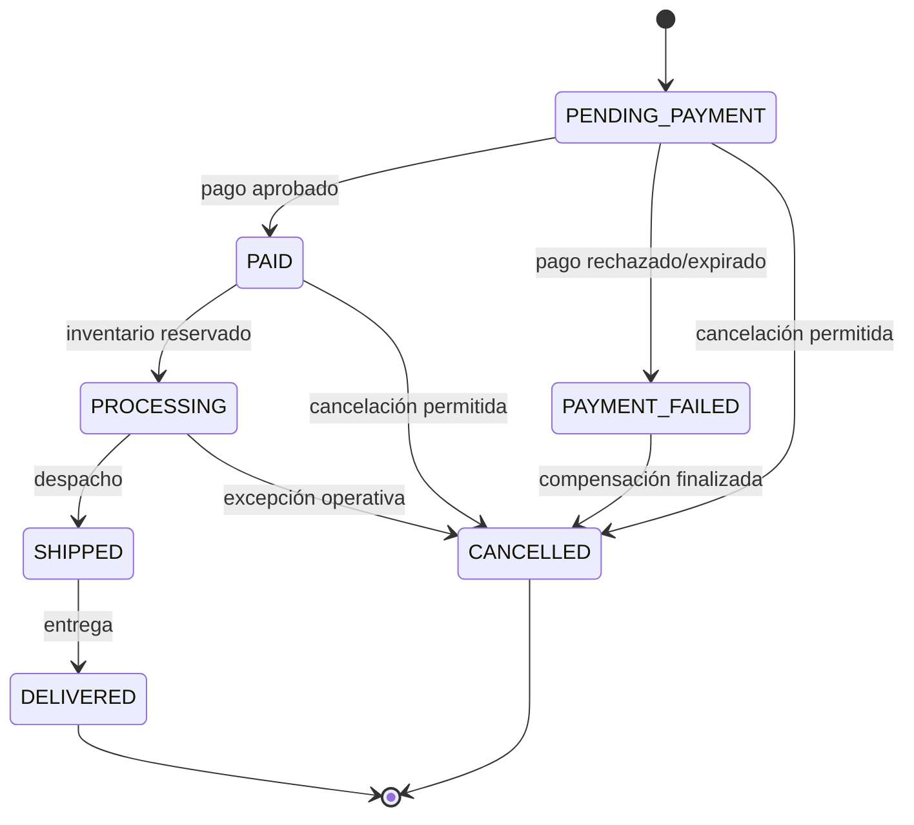
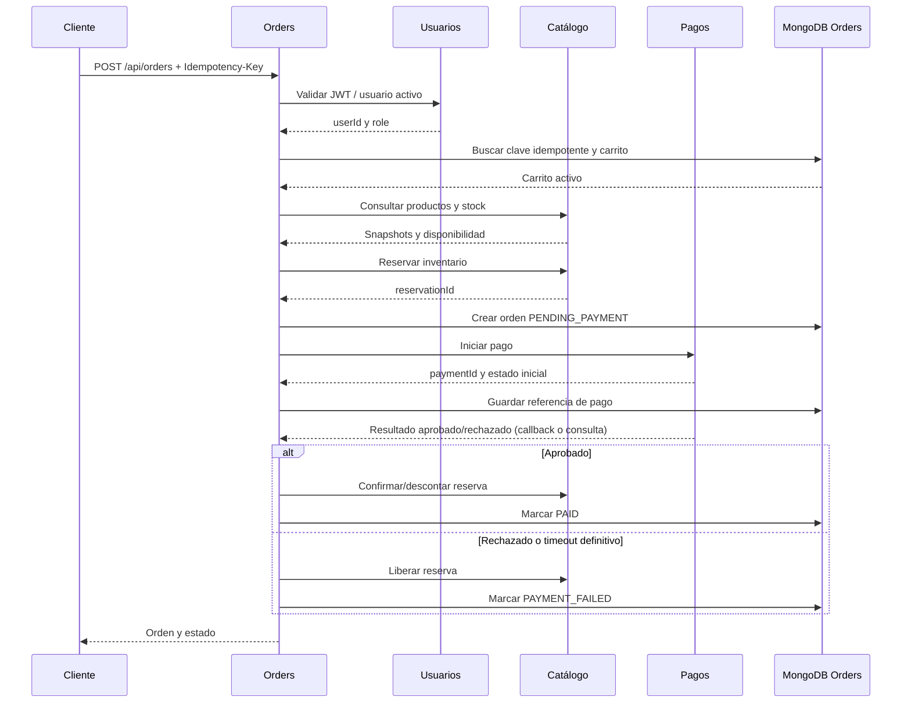

# Especificación SDD y contrato de API — Orders Service

## 1. Alcance

El Servicio de Pedidos administra el carrito activo de cada usuario, convierte un
carrito en una orden, mantiene el ciclo de vida de la orden y permite consultar
el historial de pedidos.

El servicio sí es responsable de:

- Crear y consultar el carrito activo.
- Agregar, quitar, modificar cantidades y vaciar ítems del carrito.
- Validar que los productos estén disponibles mediante el Servicio de Catálogo.
- Crear órdenes con un snapshot del nombre y precio de cada producto.
- Mantener las transiciones válidas de estado de una orden.
- Coordinar la reserva/liberación de inventario y el inicio del pago mediante
  puertos externos.
- Consultar las órdenes propias del usuario.
- Permitir operaciones administrativas autorizadas.

El servicio no es responsable de:

- Autenticar usuarios, emitir JWT ni administrar credenciales.
- Mantener el catálogo maestro de productos o el inventario como fuente de
  verdad.
- Procesar tarjetas, transferencias ni otros medios de pago.
- Realizar búsquedas de texto o recomendaciones.
- Exponer directamente la API interna de otros servicios.



El API Gateway es el punto de entrada público. Orders valida el contexto de
autorización recibido y aplica las reglas de negocio propias.

## 2. Actores y roles

### Compradores

Estudiantes, docentes y administrativos pueden:

- Consultar y modificar su carrito activo.
- Crear una orden desde su propio carrito.
- Consultar una orden propia.
- Consultar su historial paginado y filtrado por estado.
- Cancelar una orden propia cuando su estado lo permita.

### Administrador de la tienda

Puede realizar las operaciones de comprador y, además:

- Consultar órdenes de todos los usuarios.
- Filtrar y paginar órdenes administrativas.
- Cambiar el estado de una orden según las transiciones administrativas
  permitidas.

La autenticación y emisión del JWT son responsabilidad del Servicio de
Usuarios. Orders no autentica credenciales: valida el JWT recibido mediante el
puerto de Usuarios y extrae de sus claims `userId` y `role`. También debe
confirmar que la cuenta esté activa y vinculada con la Universidad del Valle.

**Supuesto:** los roles del JWT son `STUDENT`, `TEACHER`, `STAFF` y `ADMIN`.
Debe confirmarse con el responsable de Usuarios.

## 3. Requisitos funcionales

1. **RF-01 — Consultar carrito:** un comprador puede consultar su carrito
   activo, incluidos ítems, cantidades y total calculado.
2. **RF-02 — Agregar ítem:** un comprador puede agregar un producto disponible
   indicando una cantidad positiva. Si el producto ya existe, se acumula la
   cantidad.
3. **RF-03 — Cambiar cantidad:** un comprador puede establecer una nueva
   cantidad positiva para un producto existente.
4. **RF-04 — Quitar ítem:** un comprador puede quitar un producto de su carrito.
5. **RF-05 — Vaciar carrito:** un comprador puede eliminar todos los ítems de su
   carrito.
6. **RF-06 — Crear orden (checkout):** un comprador puede convertir su carrito
   no vacío en una orden, conservando snapshots de producto, precio y total.
7. **RF-07 — Idempotencia del checkout:** una misma clave
   `Idempotency-Key` no crea más de una orden para la misma operación.
8. **RF-08 — Consultar orden propia:** un comprador puede consultar una orden
   cuyo `userId` coincide con su identidad.
9. **RF-09 — Listar historial propio:** un comprador puede listar sus órdenes con
   paginación y filtro opcional por estado.
10. **RF-10 — Cancelar orden:** un comprador puede solicitar la cancelación de
    una orden propia en un estado cancelable.
11. **RF-11 — Aplicar resultado de pago:** el servicio de Pagos puede informar
    un resultado aprobado, rechazado o pendiente para una orden.
12. **RF-12 — Actualizar estado por pago:** Orders cambia el estado de la orden
    según el resultado de pago y ejecuta las compensaciones necesarias.
13. **RF-13 — Listar órdenes administrativas:** un administrador puede listar
    órdenes de todos los usuarios con paginación y filtros.
14. **RF-14 — Cambiar estado administrativo:** un administrador puede solicitar
    una transición de estado válida de una orden.
15. **RF-15 — Validar producto y disponibilidad:** antes de agregar o comprar,
    Orders consulta al Servicio de Catálogo.
16. **RF-16 — Mantener consistencia:** las operaciones no deben dejar una orden
    parcialmente creada ni un carrito activo ambiguo.

## 4. Requisitos no funcionales

- **RNF-01 — Resiliencia:** fallos de Catálogo o Pagos no deben derribar
  Orders. Deben convertirse en respuestas controladas `502` o `503`, con
  timeouts y reintentos limitados.
- **RNF-02 — Idempotencia:** checkout y recepción de resultados de pago deben
  tolerar reintentos sin duplicar órdenes ni aplicar dos veces una transición.
- **RNF-03 — Validación:** todos los cuerpos, parámetros, consultas y claims
  externos deben validarse antes de ejecutar casos de uso.
- **RNF-04 — Consistencia:** las invariantes del dominio deben protegerse en
  el dominio y las operaciones críticas deben usar controles de concurrencia.
- **RNF-05 — Trazabilidad:** carritos y órdenes deben conservar `createdAt` y
  `updatedAt`; las transiciones deben poder auditarse.
- **RNF-06 — Documentación:** los endpoints públicos deben estar descritos en
  Swagger, incluyendo respuestas de error.
- **RNF-07 — Pruebas:** habrá pruebas unitarias de dominio, casos de uso,
  controladores e integración con MongoDB.
- **RNF-08 — Seguridad:** cada recurso propio se filtra por `userId`; las
  operaciones administrativas requieren el rol `ADMIN`.
- **RNF-09 — Rendimiento:** las consultas de historial deben usar índices y
  paginación acotada, evitando cargar colecciones completas.

## 5. Modelo de dominio conceptual

### Agregados y entidades

- `Cart` es la raíz del agregado del carrito. Contiene `CartItem` y garantiza
  que cada producto aparezca una sola vez y que las cantidades sean válidas.
- `CartItem` es una entidad interna con `productId`, cantidad y datos actuales
  necesarios para mostrar el carrito.
- `Order` es la raíz del agregado de la orden. Contiene `OrderItem`, calcula el
  total y gobierna las transiciones de estado.
- `OrderItem` es una entidad interna que conserva el snapshot del producto
  comprado.

Un usuario tiene un solo `Cart` activo. Una `Order` es independiente después
del checkout y no depende de que el carrito siga existiendo.

### Value objects

- `Money`: monto entero en la unidad menor y moneda ISO; no usa decimales
  flotantes. Rechaza valores negativos y monedas distintas al operar.
- `Quantity`: entero positivo con un máximo configurable.
- `OrderStatus`: `PENDING_PAYMENT`, `PAID`, `PROCESSING`, `SHIPPED`,
  `DELIVERED`, `CANCELLED` o `PAYMENT_FAILED`.
- `UserId`, `ProductId`, `OrderId` y `CartId`: identificadores no vacíos y
  normalizados.

Todos los value objects son inmutables, validan su construcción y disponen de
`equals`.

### Reglas de negocio e invariantes

1. **RN-01:** cada usuario tiene un único carrito activo.
2. **RN-02:** una cantidad siempre es un entero positivo y no supera el máximo
   configurado.
3. **RN-03:** no se repite un producto dentro del carrito; al agregarlo se
   acumula su cantidad.
4. **RN-04:** un carrito vacío no puede convertirse en una orden.
5. **RN-05:** el total de carrito y orden es la suma de precio por cantidad de
   todos sus ítems.
6. **RN-06:** una orden conserva el nombre, precio, moneda y `productId` que
   tenían los productos al momento del checkout.
7. **RN-07:** una orden no puede modificar sus ítems ni su total después de
   crearse.
8. **RN-08:** cada transición de estado debe pertenecer a la máquina definida
   en la sección 6.
9. **RN-09:** una orden no entregada ni cancelada solo puede cancelarse en los
   estados explícitamente permitidos.
10. **RN-10:** una respuesta de pago repetida no puede retroceder ni duplicar el
    estado de una orden.
11. **RN-11:** el propietario solo puede acceder a sus propias órdenes.
12. **RN-12:** una orden debe tener al menos un ítem y un total no negativo.

## 6. Estados y transiciones de la orden

| Origen | Destino | Disparador | Condición |
|---|---|---|---|
| `PENDING_PAYMENT` | `PAID` | Pagos | Pago aprobado y orden vigente |
| `PENDING_PAYMENT` | `PAYMENT_FAILED` | Pagos | Pago rechazado o expirado |
| `PENDING_PAYMENT` | `CANCELLED` | Comprador o administrador | Cancelación permitida |
| `PAID` | `PROCESSING` | Orders o administrador | Inventario reservado correctamente |
| `PAID` | `CANCELLED` | Comprador o administrador | Cancelación antes de procesamiento |
| `PROCESSING` | `SHIPPED` | Administrador/logística | Orden despachada |
| `PROCESSING` | `CANCELLED` | Administrador | Excepción operativa con compensación |
| `SHIPPED` | `DELIVERED` | Administrador/logística | Entrega confirmada |
| `PAYMENT_FAILED` | `CANCELLED` | Orders | Fallo confirmado y compensación ejecutada |

`DELIVERED` y `CANCELLED` son estados finales. No se permite reabrir una orden,
marcar como pagada una orden cancelada, cancelar una orden entregada ni saltar
directamente a un estado no autorizado. Las transiciones inválidas generan un
error de dominio `InvalidOrderTransitionError`, mapeado a HTTP `409`.



## 7. Casos de uso

### AddItemToCart

- **Actor:** comprador.
- **Precondiciones:** JWT válido; producto existente y cuenta activa.
- **Flujo:** validar cantidad; consultar producto y disponibilidad; obtener el
  carrito activo; agregar o acumular el producto; persistir.
- **Errores:** producto inexistente `404`, cantidad inválida `422`, stock
  insuficiente `409`, Catálogo no disponible `503`.
- **Postcondición:** carrito persistido con un ítem o cantidad actualizada.

### RemoveItemFromCart

- **Actor:** comprador.
- **Precondiciones:** JWT válido y carrito activo.
- **Flujo:** localizar el producto y eliminarlo del agregado.
- **Errores:** producto ausente `404`.
- **Postcondición:** el producto ya no pertenece al carrito.

### UpdateCartItemQuantity

- **Actor:** comprador.
- **Precondiciones:** JWT válido; ítem existente.
- **Flujo:** validar la nueva cantidad; consultar disponibilidad; cambiarla y
  persistir.
- **Errores:** cantidad inválida `422`, ítem ausente `404`, stock insuficiente
  `409`, Catálogo no disponible `503`.
- **Postcondición:** cantidad reemplazada.

### ClearCart

- **Actor:** comprador.
- **Precondiciones:** JWT válido.
- **Flujo:** cargar el carrito activo, eliminar todos sus ítems y persistir.
- **Errores:** errores de persistencia `503`.
- **Postcondición:** carrito vacío.

### GetCart

- **Actor:** comprador.
- **Precondiciones:** JWT válido.
- **Flujo:** cargar el carrito activo o devolver uno vacío inicializado.
- **Errores:** errores de persistencia `503`.
- **Postcondición:** representación del carrito con total calculado.

### CreateOrderFromCart

- **Actor:** comprador.
- **Precondiciones:** JWT válido; carrito no vacío; `Idempotency-Key` válida.
- **Flujo:** verificar idempotencia; consultar productos; congelar snapshots;
  reservar inventario; crear orden `PENDING_PAYMENT`; vaciar o cerrar el
  carrito; iniciar pago; persistir resultado de coordinación.
- **Flujos alternos:** clave repetida devuelve la orden original; stock
  insuficiente cancela la operación; fallo de Pagos conserva la orden como
  `PENDING_PAYMENT` o `PAYMENT_FAILED` según el contrato confirmado.
- **Postcondición:** una única orden asociada al usuario.

### GetOrderById

- **Actor:** comprador o administrador.
- **Precondiciones:** JWT válido; propietario o rol `ADMIN`.
- **Flujo:** consultar por identificador y comprobar autorización.
- **Errores:** orden ausente `404`, acceso no autorizado `403`.
- **Postcondición:** devuelve la orden sin exponer datos internos innecesarios.

### ListUserOrders

- **Actor:** comprador.
- **Precondiciones:** JWT válido.
- **Flujo:** consultar por `userId`, aplicar estado opcional, ordenar por fecha
  descendente y paginar.
- **Errores:** parámetros inválidos `422`.
- **Postcondición:** página de órdenes y metadatos de paginación.

### CancelOrder

- **Actor:** comprador o administrador.
- **Precondiciones:** JWT válido; orden propia o rol `ADMIN`; estado cancelable.
- **Flujo:** validar transición; liberar inventario si aplica; cambiar a
  `CANCELLED`; persistir.
- **Errores:** orden ausente `404`, sin permisos `403`, transición inválida
  `409`, Catálogo no disponible `503`.
- **Postcondición:** orden cancelada sin reabrirse.

### ApplyPaymentResult

- **Actor:** servicio de Pagos mediante canal interno autenticado.
- **Precondiciones:** evento o solicitud válida e idempotente.
- **Flujo:** localizar orden; comprobar referencia de pago; aplicar aprobado,
  rechazado o pendiente; reservar/procesar o liberar inventario.
- **Errores:** orden ausente `404`, resultado inconsistente `409`, Pagos no
  autorizado `401/403`.
- **Postcondición:** estado actualizado una sola vez.

### ListOrdersAdmin

- **Actor:** administrador.
- **Precondiciones:** JWT válido con rol `ADMIN`.
- **Flujo:** validar filtros, consultar índices, paginar y devolver órdenes.
- **Errores:** rol insuficiente `403`, filtros inválidos `422`.
- **Postcondición:** página administrativa.

### UpdateOrderStatusAdmin

- **Actor:** administrador.
- **Precondiciones:** JWT válido con rol `ADMIN`; transición válida.
- **Flujo:** cargar orden, validar transición, ejecutar compensación si procede
  y persistir.
- **Errores:** orden ausente `404`, rol insuficiente `403`, transición inválida
  `409`, dependencia no disponible `503`.
- **Postcondición:** estado actualizado y trazable.

## 8. Contrato REST

Todos los endpoints usan el prefijo global `/api`. El formato de error único es:

```json
{
  "statusCode": 409,
  "code": "ORDER_INVALID_TRANSITION",
  "message": "La transición de estado no está permitida",
  "details": {},
  "timestamp": "2026-01-15T12:00:00.000Z",
  "path": "/api/orders/ord_123"
}
```

Los errores comunes son `400` (sintaxis o parámetros mal formados), `401`
(JWT ausente o inválido), `403` (rol o propietario insuficiente), `404`
(recurso inexistente), `409` (conflicto o regla de negocio), `422` (validación
semántica), `502` (respuesta inválida de una dependencia) y `503` (dependencia
no disponible o timeout).

### Resumen de endpoints

| Método | Ruta | Roles | Exposición |
|---|---|---|---|
| `GET` | `/api/cart` | Comprador | Gateway |
| `POST` | `/api/cart/items` | Comprador | Gateway |
| `PATCH` | `/api/cart/items/:productId` | Comprador | Gateway |
| `DELETE` | `/api/cart/items/:productId` | Comprador | Gateway |
| `DELETE` | `/api/cart` | Comprador | Gateway |
| `POST` | `/api/orders` | Comprador | Gateway |
| `GET` | `/api/orders` | Comprador | Gateway |
| `GET` | `/api/orders/:id` | Propietario/admin | Gateway |
| `POST` | `/api/orders/:id/cancel` | Propietario/admin | Gateway |
| `POST` | `/api/orders/:id/payment-result` | Pagos interno | Solo interno |
| `GET` | `/api/admin/orders` | `ADMIN` | Gateway |
| `PATCH` | `/api/admin/orders/:id/status` | `ADMIN` | Gateway |

### Carrito

#### `GET /api/cart`

No recibe cuerpo. Responde `200`:

```json
{
  "id": "cart_123",
  "userId": "user_123",
  "items": [
    {
      "productId": "prod_123",
      "name": "Cuaderno Univalle",
      "unitPrice": { "amount": 125000, "currency": "COP" },
      "quantity": 2,
      "subtotal": { "amount": 250000, "currency": "COP" }
    }
  ],
  "total": { "amount": 250000, "currency": "COP" },
  "updatedAt": "2026-01-15T12:00:00.000Z"
}
```

#### `POST /api/cart/items`

Body:

```json
{ "productId": "prod_123", "quantity": 2 }
```

Responde `201` con el carrito actualizado. Errores adicionales: `404` producto
inexistente, `409` stock insuficiente y `503` Catálogo no disponible.

#### `PATCH /api/cart/items/:productId`

Body:

```json
{ "quantity": 3 }
```

Responde `200` con el carrito actualizado. Errores adicionales: `404`, `409` y
`503`.

#### `DELETE /api/cart/items/:productId`

Responde `204` sin cuerpo. Si el producto no está en el carrito, responde `404`
según la decisión de UX que confirme el equipo.

#### `DELETE /api/cart`

Responde `204` sin cuerpo. Repetir la operación es seguro.

### Órdenes

#### `POST /api/orders`

Cabecera obligatoria:

```text
Idempotency-Key: checkout-2026-0001
```

Body opcional:

```json
{ "paymentMethod": "CARD" }
```

Responde `201`:

```json
{
  "id": "ord_123",
  "userId": "user_123",
  "status": "PENDING_PAYMENT",
  "items": [
    {
      "productId": "prod_123",
      "name": "Cuaderno Univalle",
      "unitPrice": { "amount": 125000, "currency": "COP" },
      "quantity": 2,
      "subtotal": { "amount": 250000, "currency": "COP" }
    }
  ],
  "total": { "amount": 250000, "currency": "COP" },
  "createdAt": "2026-01-15T12:00:00.000Z",
  "updatedAt": "2026-01-15T12:00:00.000Z"
}
```

La misma clave con el mismo usuario y payload devuelve la orden ya creada
(`200` o `201`, pendiente de confirmar). Una clave reutilizada con distinto
payload devuelve `409`. Otros errores: `400`, `401`, `409`, `422`, `502` y
`503`.

#### `GET /api/orders`

Query:

```text
page=1&limit=20&status=PAID
```

Responde `200`:

```json
{
  "items": [],
  "page": 1,
  "limit": 20,
  "totalItems": 0,
  "totalPages": 0
}
```

`limit` debe estar acotado, por defecto `20` y máximo supuesto `100`.

#### `GET /api/orders/:id`

Responde `200` con el objeto de orden mostrado en el checkout. Un usuario
distinto recibe `403` y un identificador inexistente `404`.

#### `POST /api/orders/:id/cancel`

Body opcional:

```json
{ "reason": "El usuario cambió de opinión" }
```

Responde `200` con la orden cancelada. Puede responder `409` si el estado no
permite cancelar y `503` si no puede liberar el inventario.

#### `POST /api/orders/:id/payment-result`

Endpoint solo interno. Body:

```json
{
  "paymentId": "pay_123",
  "result": "APPROVED",
  "idempotencyKey": "payment-event-123"
}
```

`result` puede ser `APPROVED`, `REJECTED` o `PENDING`. Responde `200` con la
orden actualizada. Requiere autenticación entre servicios y no debe exponerse
al cliente final mediante el Gateway.

### Administración

#### `GET /api/admin/orders`

Query:

```text
page=1&limit=20&status=PROCESSING&userId=user_123
```

Responde `200` con la misma estructura paginada de `GET /api/orders`.

#### `PATCH /api/admin/orders/:id/status`

Body:

```json
{ "status": "SHIPPED" }
```

Responde `200` con la orden actualizada. Solo `ADMIN`; errores principales:
`401`, `403`, `404`, `409`, `422` y `503`.

## 9. Puertos y contratos con otros servicios

Los puertos son interfaces del dominio/aplicación. No contienen HTTP, Mongoose
ni detalles de transporte.

### Usuarios

**Implementa el adaptador:** compañero responsable de Usuarios, mediante un
contrato REST o mecanismo interno acordado.

```text
validateToken(token: string): Promise<AuthenticatedUser>
getBasicUser(userId: UserId): Promise<UserSummary>

AuthenticatedUser = {
  userId: UserId,
  role: UserRole,
  active: boolean,
  univalleAffiliation: "STUDENT" | "TEACHER" | "STAFF"
}
UserSummary = { userId: UserId, role: UserRole, active: boolean }
```

### Catálogo

**Implementa el adaptador:** compañero responsable del Catálogo.

```text
getProduct(productId: ProductId): Promise<ProductSnapshot>
checkAvailability(productId: ProductId, quantity: Quantity): Promise<Availability>
reserveStock(reservation: StockReservation): Promise<ReservationResult>
releaseStock(reservationId: string): Promise<void>
commitStock(reservationId: string): Promise<void>

ProductSnapshot = {
  productId: ProductId,
  name: string,
  unitPrice: Money,
  available: boolean,
  stock: number
}
```

La semántica exacta de reservar, descontar y liberar debe confirmarse con
Catálogo. Orders solo depende de la abstracción.

### Pagos

**Implementa el adaptador:** compañero responsable de Pagos.

```text
startPayment(request: StartPaymentRequest): Promise<PaymentInitiated>
handlePaymentResult(result: PaymentResult): Promise<void>

StartPaymentRequest = {
  orderId: OrderId,
  userId: UserId,
  amount: Money,
  idempotencyKey: string
}
PaymentInitiated = {
  paymentId: string,
  status: "PENDING" | "APPROVED" | "REJECTED"
}
PaymentResult = {
  paymentId: string,
  orderId: OrderId,
  result: "APPROVED" | "REJECTED" | "PENDING",
  eventId: string
}
```

El callback/webhook o la respuesta síncrona debe definirse con Pagos.

### Persistencia

**Implementa el adaptador:** Orders, en infraestructura.

```text
CartRepository:
  findActiveByUserId(userId: UserId): Promise<Cart | null>
  save(cart: Cart): Promise<void>

OrderRepository:
  findById(orderId: OrderId): Promise<Order | null>
  findByIdempotencyKey(userId: UserId, key: string): Promise<Order | null>
  save(order: Order): Promise<void>
  listByUser(userId: UserId, filter: OrderFilter, page: PageRequest): Promise<Page<Order>>
  listAll(filter: AdminOrderFilter, page: PageRequest): Promise<Page<Order>>
```

### Otros puertos

**Implementa Orders:**

```text
ClockPort:
  now(): Date

IdGeneratorPort:
  nextCartId(): CartId
  nextOrderId(): OrderId
  nextReservationId(): string
```

Un publicador de eventos podrá agregarse cuando el contrato de integración lo
requiera. Su implementación debe ser responsabilidad de infraestructura de
Orders y no del dominio.

## 10. Modelo de datos en MongoDB

### Colección `carts`

```json
{
  "_id": "cart_123",
  "userId": "user_123",
  "status": "ACTIVE",
  "items": [
    {
      "productId": "prod_123",
      "name": "Cuaderno Univalle",
      "unitPrice": { "amount": 125000, "currency": "COP" },
      "quantity": 2
    }
  ],
  "createdAt": "2026-01-15T12:00:00.000Z",
  "updatedAt": "2026-01-15T12:05:00.000Z"
}
```

Índices:

- Único compuesto `{ userId: 1, status: 1 }` para un solo carrito `ACTIVE`
  por usuario, idealmente con índice parcial.
- `{ updatedAt: -1 }` para tareas de expiración o mantenimiento.

### Colección `orders`

```json
{
  "_id": "ord_123",
  "userId": "user_123",
  "status": "PENDING_PAYMENT",
  "items": [
    {
      "productId": "prod_123",
      "name": "Cuaderno Univalle",
      "unitPrice": { "amount": 125000, "currency": "COP" },
      "quantity": 2,
      "subtotal": { "amount": 250000, "currency": "COP" }
    }
  ],
  "total": { "amount": 250000, "currency": "COP" },
  "currency": "COP",
  "idempotencyKey": "checkout-2026-0001",
  "paymentId": null,
  "reservationId": null,
  "statusHistory": [
    {
      "from": null,
      "to": "PENDING_PAYMENT",
      "at": "2026-01-15T12:00:00.000Z",
      "actor": "user_123"
    }
  ],
  "createdAt": "2026-01-15T12:00:00.000Z",
  "updatedAt": "2026-01-15T12:00:00.000Z"
}
```

Índices:

- Único `{ userId: 1, idempotencyKey: 1 }` para checkout idempotente.
- `{ userId: 1, createdAt: -1 }` para historial propio.
- `{ status: 1, createdAt: -1 }` para filtros administrativos.
- `{ createdAt: -1 }` para orden general.

Los ítems se incrustan porque el carrito y la orden tienen límites acotados,
se leen como unidad y deben conservar consistencia con su raíz. La orden
incrusta snapshots para que cambios posteriores del Catálogo no alteren el
historial ni el importe cobrado.

**Supuesto:** el dinero se almacena como entero en centavos/unidad menor y la
moneda inicial es `COP`. Debe confirmarse con el equipo.

## 11. Flujo de checkout



La coordinación debe ser tolerante a reintentos. Si falla Pagos después de
crear la orden, la orden queda recuperable en `PENDING_PAYMENT`; no se debe
crear una segunda orden. Si la reserva no puede mantenerse, se libera y se
marca el fallo según el contrato de Catálogo.

## 12. Manejo de errores y resiliencia

| Error de dominio | Código | HTTP |
|---|---|---|
| `InvalidQuantityError` | `CART_INVALID_QUANTITY` | `422` |
| `EmptyCartError` | `CART_EMPTY` | `409` |
| Producto inexistente | `PRODUCT_NOT_FOUND` | `404` |
| Stock insuficiente | `INSUFFICIENT_STOCK` | `409` |
| Orden inexistente | `ORDER_NOT_FOUND` | `404` |
| Acceso a recurso ajeno | `ORDER_FORBIDDEN` | `403` |
| Transición inválida | `ORDER_INVALID_TRANSITION` | `409` |
| Clave idempotente conflictiva | `IDEMPOTENCY_CONFLICT` | `409` |
| Datos externos inválidos | `DEPENDENCY_INVALID_RESPONSE` | `502` |
| Timeout o indisponibilidad | `DEPENDENCY_UNAVAILABLE` | `503` |

Los adaptadores deben establecer timeouts finitos, realizar como máximo dos
reintentos para errores transitorios y no reintentar errores de validación.
Circuit breaker y backoff podrán incorporarse si el tráfico lo justifica.

La capa HTTP transforma errores tipados a la respuesta única de la sección 8.
No se deben ocultar excepciones de persistencia ni devolver respuestas exitosas
cuando una operación crítica no se confirmó.

## 13. Estrategia de pruebas

- **Dominio:** value objects válidos e inválidos; operaciones de `Money`;
  cantidades; acumulación y unicidad de productos; carrito vacío; creación de
  orden; cálculo total; snapshots; transiciones válidas e inválidas.
- **Casos de uso:** dobles de `CartRepository`, `OrderRepository`, Usuarios,
  Catálogo, Pagos, reloj e IDs; verificar llamadas, compensaciones e
  idempotencia.
- **Controladores:** validación de cuerpos y parámetros, autenticación,
  autorización, códigos HTTP y formato de error.
- **Integración MongoDB:** índices, persistencia de documentos, consultas
  paginadas y unicidad de carrito/idempotencia.
- **Contrato:** Swagger y pruebas de endpoints con dependencias simuladas.
- **Resiliencia:** timeout de Catálogo/Pagos, respuesta inválida, reintentos
  limitados y liberación de inventario.

## 14. Decisiones abiertas y supuestos

| Decisión | Opciones | Supuesto por defecto | Confirmar con |
|---|---|---|---|
| Quién descuenta inventario | Catálogo al reservar; Orders directamente | Catálogo reserva y confirma | Catálogo |
| Momento del descuento | Al checkout; al aprobar pago; al despacho | Reservar en checkout y confirmar tras pago | Catálogo/Pagos |
| Resultado de pago | Callback; polling; respuesta síncrona | Callback interno idempotente | Pagos |
| Claims del JWT | `sub`/`role`; `userId`/`role` | `userId`, `role`, estado/afiliación disponibles | Usuarios |
| Carrito expira | Nunca; TTL; al checkout | No expira en la primera versión | Equipo/Usuarios |
| Máximo por ítem | 10; 99; configurable | 99 unidades, configurable | Catálogo |
| Moneda | COP; multi-moneda | COP y entero en unidad menor | Equipo/Pagos |
| Precio congelado | En carrito; en checkout | Se congela en checkout | Catálogo/Pagos |
| Cancelación | Solo antes de `PROCESSING`; también durante `PROCESSING` | Antes de `PROCESSING` | Equipo |
| Respuesta idempotente | `200` repetido; `201` repetido | `200` para reintento ya resuelto | API Gateway |
| Autenticación interna | JWT de servicio; API key; mTLS | JWT/API key entre servicios | Usuarios/Pagos |
| Convención de IDs | Mongo ObjectId; UUID; prefijo | IDs string con prefijo | Equipo |
| Límite de página | 20; 50; 100 | 20 por defecto, 100 máximo | Equipo |

Estas decisiones no bloquean la especificación inicial, pero deben confirmarse
antes de implementar adaptadores o integrar los servicios compañeros.

## 15. Plan de implementación

1. Confirmar con Usuarios, Catálogo y Pagos las decisiones abiertas y congelar
   el contrato de integración.
2. Implementar value objects, errores y entidades de dominio.
3. Implementar puertos de persistencia, reloj, IDs y servicios externos.
4. Crear pruebas unitarias exhaustivas del dominio.
5. Implementar casos de uso de carrito y sus pruebas con dobles.
6. Implementar checkout, idempotencia, compensaciones y sus pruebas.
7. Implementar esquemas, repositorios e índices MongoDB.
8. Implementar adaptadores HTTP de Catálogo, Pagos y Usuarios con timeout,
   reintentos y mapeo de errores.
9. Implementar controladores REST, DTOs, autorización y documentación Swagger.
10. Añadir integración con MongoDB, pruebas e2e y pruebas de contrato.
11. Integrar Docker Compose y variables de entorno de los servicios.
12. Actualizar README y documentación de operación.
13. Ejecutar build, lint, pruebas unitarias, integración y smoke tests Docker.

